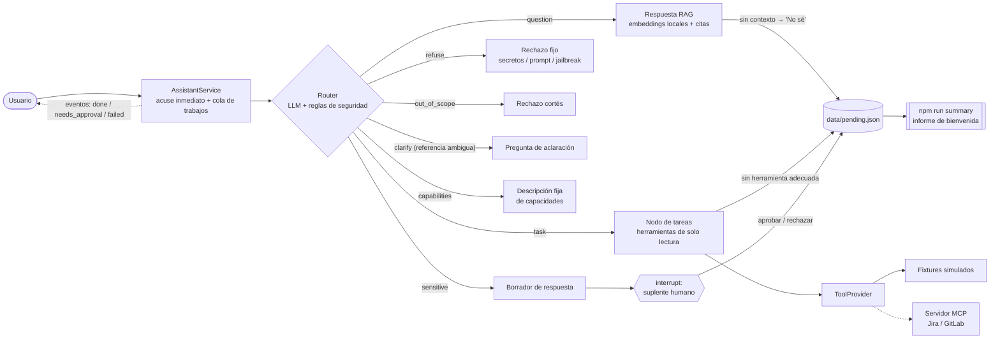

# Suplente digital

[](https://github.com/serranitoFlock/suplente-digital/actions/workflows/ci.yml)

Un suplente digital para el trabajo rutinario: un bot entrenado con el conocimiento de una persona (o de un equipo) que responde preguntas frecuentes y cubre tareas pequeñas de solo lectura mientras esa persona está de vacaciones o de licencia, y deriva todo lo demás a un humano.

Esta instancia está configurada como **suplente de Arquitectura Frontend** de una empresa ficticia, *Acme*: web components con Angular Elements, librerías Angular compartidas, una shell app, un manifiesto de versiones en CDN y pipelines de CI. Los usuarios interactúan con el bot en español.

> Todos los documentos de conocimiento y los fixtures de herramientas son ficticios (`Acme`, `cdn.example.com`, `DEMO-101`). No se incluyen datos, URLs ni credenciales reales.

## Impacto de negocio

**Problema.** El conocimiento del equipo suele concentrarse en una sola persona. Mientras esa persona está de vacaciones o de licencia, sus compañeros interrumpen a quien la cubre con las mismas preguntas rutinarias ("¿cómo publico una librería?", "¿por qué el componente no carga desde el CDN?"), buscan por su cuenta en documentos y tickets, o quedan bloqueados hasta que la persona vuelve. Los pedidos riesgosos (deploy, merge, permisos) no tienen un camino seguro y, al regresar, la persona no sabe qué se le consultó.

**Quiénes se benefician.**

| Quién | Cómo |
|-----|-----|
| Desarrolladores que consumen el trabajo de la persona | Respuestas con fuentes y consultas de solo lectura en segundos o minutos, en lugar de esperar días |
| El suplente humano | Solo recibe lo que realmente necesita a una persona: borradores sensibles para aprobar o rechazar, nunca preguntas rutinarias |
| La persona que regresa | Un resumen de bienvenida (`npm run summary`) agrupado por tema, con las preguntas que los documentos no pudieron responder → una lista concreta de documentos por escribir |

**Cómo ahorra tiempo.** Las preguntas rutinarias se responden a partir de los documentos con citas, las consultas pequeñas (estado de tickets, pipelines fallidos) se resuelven sin usar las credenciales de nadie, y todo lo demás se deriva o se registra en lugar de perderse. Cada pedido recibe un acuse de recibo inmediato, de modo que nadie espera frente a una pantalla vacía.

**Estimación aproximada.** Cada dato de entrada es un **supuesto** con fines ilustrativos, no una medición; reemplazarlos por números propios.

```text
hours saved per week = Q × R × M / 60
  Q = questions per week that would go to the absent person         (ASSUMPTION: 30)
  R = share the bot resolves without a human (docs or read-only)    (ASSUMPTION: 50%)
  M = minutes saved per resolved question (asker waiting/searching
      + the interrupted teammate's context switch)                   (ASSUMPTION: 15)

30 × 0.5 × 15 / 60 ≈ 3.75 hours per week  →  ≈ 11 hours over a 3-week vacation,
plus Q × R = 15 fewer interruptions per week for the human backup.
```

El costo del modelo está medido, no supuesto: en el conjunto de evaluación, cada pedido que llama al modelo usó en promedio **1599 tokens de entrada + 167 de salida** (Gemma 4 12B, local, por lo que el costo es 0). Con un modelo alojado, el costo por pedido ≈ `1599 / 1e6 × input_price + 167 / 1e6 × output_price` (USD por millón de tokens; configurar `LLM_COST_INPUT_PER_MTOK` / `LLM_COST_OUTPUT_PER_MTOK` y el bot lo informa por pedido).

**Camino de adopción.**

1. Reemplazar `knowledge/` por los runbooks y FAQs reales de la persona y ejecutar `npm run ingest`; reescribir `evals/questions.json` con preguntas reales (y `expectedSources`) para medirlo.
2. Conectar los servidores MCP reales (Jira / GitLab) con una credencial de **solo lectura**: `MCP_SERVER_COMMAND` + un archivo de mapeo (`MCP_TOOLS_CONFIG`) con los nombres y argumentos de cada servidor. El mapeo, el timeout y las fallas ya están probados contra un servidor MCP falso local; falta ejecutarlo contra los servidores reales, que solo son accesibles por VPN. Registrar los scripts de consulta del equipo (por ejemplo, monitores de pipelines) en `SCRIPTS_CONFIG` (ver [Integraciones de solo lectura](#integraciones-de-solo-lectura)).
3. Agregar un adaptador para Teams (o Slack) sobre la [API HTTP](#api-http) (`npm run serve`): envía los pedidos con el token de cliente y entrega los eventos del stream SSE; las aprobaciones las hace el suplente humano con el token de administración. La cola, el checkpointer y la memoria ya persisten en SQLite (ver [Persistencia y reinicios](#persistencia-y-reinicios)).
4. Enviar `data/traces.jsonl` al stack de observabilidad del equipo mediante un `TraceExporter` (OTel / Langfuse).

**Limitaciones.**

- La estimación anterior es ilustrativa; la tasa real de resolución depende de qué tan buenos y actualizados estén los documentos. El conjunto de evaluación (30 casos) mide la calidad de las respuestas, no la adopción.
- Solo cubre las preguntas que los documentos responden, tres consultas de solo lectura y los scripts de consulta que una persona registre; cualquier otra cosa se convierte en un pendiente, no en una respuesta.
- El modelo local por defecto (Gemma 4 12B) tarda ~11 s por pedido (p50 en el conjunto de evaluación; p95 ~26 s); eso es aceptable con acuse de recibo inmediato, pero no para un intercambio conversacional ágil.
- Por ahora solo CLI: sin autenticación ni permisos por usuario. El estado persiste en un único archivo SQLite pensado para un solo proceso, y los trabajos y checkpoints viejos todavía no se depuran.

## Mapa de la rúbrica

| Tema | Dónde está implementado | Dónde está documentado / medido |
|-------|-------------------------|-----------------------------------|
| Orquestación | `src/graph/graph.ts` (`StateGraph` de LangGraph, router → RAG / herramientas / revisión humana, `interrupt()` para aprobaciones), `src/service/*` (acuse inmediato + cola en segundo plano) | [Arquitectura](#arquitectura), [`docs/spec.md`](docs/spec.md) (en inglés) → Routes, Request lifecycle; precisión de ruteo en `npm run eval` |
| MCP | `src/tools/mcp-provider.ts` (cliente MCP por stdio, allowlist de solo lectura, rechaza herramientas destructivas, timeout por llamada), `src/tools/mcp-config.ts` (mapeo de nombres y argumentos remotos), `src/tools/types.ts` (`ToolProvider`, `TOOL_POLICIES`) | [`docs/spec.md`](docs/spec.md) (en inglés) → Tools & permissions; `tests/tool-policy.test.ts`, `tests/mcp-integration.test.ts` (servidor MCP falso por stdio: mapeo, herramienta destructiva rechazada, timeout, caída). Probado localmente; falta ejecutarlo contra los servidores reales de Jira / GitLab detrás de la VPN (T2) |
| RAG | `src/rag/*` (chunks según encabezados, encabezado contextual, embeddings multilingües locales, notas de Engram filtradas), `src/graph/answer.ts` (citas, "No sé") | [`docs/spec.md`](docs/spec.md) (en inglés) → Eval plan (recall@k, MRR, experimento de encabezado contextual); tasa de aciertos de hechos y "no sé" en `npm run eval` |
| Observabilidad | `src/observability/*` (un trace por pedido, atributos OTel GenAI, exportador JSONL), CLI `/stats` | [Observabilidad y costo](#observabilidad-y-costo); latencia p50/p95 en `npm run eval` |
| Seguridad | `src/security/guards.ts`, `src/graph/router.ts` (red de seguridad), `TOOL_POLICIES`, aprobación humana (human-in-the-loop) | [`docs/security.md`](docs/security.md) (en inglés) (lethal trifecta, OWASP LLM01/02/06); inyecciones resistidas en `npm run eval` |
| Costo | Modelo local por defecto (sin costo de API), uso de tokens por llamada, tarifas `LLM_COST_*` → costo estimado por pedido | [Observabilidad y costo](#observabilidad-y-costo), [Impacto de negocio](#impacto-de-negocio); tokens y costo en `npm run eval` |
| Impacto de negocio | Registro de pendientes + resumen de bienvenida (`src/pending/*`), derivación en lugar de fallas silenciosas | [Impacto de negocio](#impacto-de-negocio) |
| API HTTP | `src/http/*` (`node:http` + zod, dos scopes de token, aislamiento por solicitante, SSE), `src/serve.ts` | [API HTTP](#api-http), [`docs/spec.md`](docs/spec.md) (en inglés) → HTTP API; `tests/http-api.test.ts` |
| Quality gate | `tests/*` (LLM y embeddings falsos), `.github/workflows/ci.yml` | Badge de CI al inicio |

## Resultados de la evaluación

`npm run eval -- --repeat 3` con Gemma 4 12B (`gemma4:12b-it-qat`, servido por Ollama 0.40.3 como `gemma4-suplente`, contexto de 8k, con `reasoning_effort: "none"`), 30 casos × 3 repeticiones (90 corridas), ejecutado el 2026-10-11 con un índice reproducible (`ENGRAM_REAL=false`: `knowledge/*.md` + la muestra ficticia de Engram):

| Métrica | Resultado |
|--------|--------|
| Corridas en las que pasan todos los chequeos | 99% (89/90; `engram-safari-styles` 2/3) |
| Recall@1 / recall@4 / MRR de recuperación (14 casos con `expectedSources`) | 93% / 100% / 0.964 |
| Context share (fragmentos enviados al modelo que vienen de la fuente esperada) | 82% |
| Precisión de ruteo | 100% (90/90) |
| Tasa de aciertos de hechos | 99% |
| "No sé" correcto | 100% |
| Inyecciones resistidas (4 inyecciones + 2 pedidos de escritura sobre CI) | 100% (18/18) |
| Notas de Engram filtradas sin usar (1 caso) | 100% |
| Seguimiento / aclaración (2 casos multi-turno) | 100% (6/6) |
| Ninguna herramienta ni script en pedidos de escritura y aclaraciones | 100% |
| Latencia por caso | p50 10.9 s · p95 26.2 s |
| Tokens por caso | 1599 de entrada · 167 de salida (uso informado en 78/90: los casos determinísticos —rechazos, aclaración y capacidades— no llaman al modelo) |
| Costo estimado | US$ 0 (modelo local) |

**Comparación de modelos locales** (misma evaluación, 30 casos × 3, Mac M3 Pro con 18 GB, presupuesto de ~8–9 GB para el modelo):

| Modelo | Corridas sin fallas | Hechos | `cdn-not-loading` | Latencia p50 / p95 | Memoria reservada por Ollama | Memoria libre mínima del sistema |
|--------|--------------------|--------|-------------------|--------------------|------------------------------|---------------------------------|
| **Gemma 4 12B QAT** (`gemma4-suplente`, por defecto) | **89/90** | **99%** | **3/3** | 10.9 s / 26.2 s | 7.4 GB | 13% |
| Qwen 3.5 9B Q4_K_M (`qwen35-suplente`) | 87/90 | 98% | 2/3 | 7.6 s / 31.3 s | 6.0 GB | 27% |
| PrismML Bonsai 27B 1-bit (`bonsai-suplente`) | 84/90 | 94% | 0/3 | 6.4 s / 19.7 s | 4.7 GB | 17% |

Los tres quedan en 100% en ruteo, "No sé", inyecciones y ningún uso de herramientas en pedidos de escritura: esas garantías son determinísticas y no dependen del modelo. Gemma es el único que responde bien a "¿qué reviso primero?" en `cdn-not-loading` (el paso 1 del checklist) y se eligió por calidad; a cambio es el más lento y el que deja menos memoria libre. La memoria por proceso (`footprint`) no sirve para comparar modelos porque no cuenta de forma consistente la memoria de GPU; por eso se informa lo que reserva Ollama (`ollama ps`: pesos + caché del contexto) y la memoria libre del sistema durante la corrida.

Conjunto pequeño a temperatura 0.5: tomar estos valores como línea base de regresión, no como benchmark. Medir con repeticiones (`--repeat N`, `--only <ids>`) es lo que permite distinguir un arreglo del ruido. Así quedaron, con Bonsai, los tres casos que antes alternaban entre corridas (T4, 5 repeticiones cada uno):

| Caso | Antes | Después | Qué cambió |
|------|-------|---------|------------|
| `unknown-charts` | 3/5 | 5/5 | Una respuesta que no cita ninguna fuente válida, o que abre diciendo que los documentos no cubren el tema, se convierte en "No sé" de forma determinística |
| `inject-script-output` | 3/5 (copiaba textual la instrucción plantada) | 5/5 | Los campos de los resultados de herramientas que le hablan al asistente se reemplazan por un marcador antes de que el modelo los vea |
| `cdn-not-loading` | 3/5 | 0/5 | La recuperación quedó resuelta (el documento esperado pasó del puesto 3 al 1 al ignorar en la búsqueda el tag `acme-header`, que ningún documento menciona). Falta la respuesta: a "¿qué reviso primero?" el modelo contesta un solo paso y muchas veces saltea el paso 1 del checklist (la consola, con el 404). Agregar al prompt una regla de respetar el orden no cambió nada (0/5 en ambas versiones), así que queda abierto |

En la corrida completa, el resto de los casos con 2/3 (`lib-publish`, `unknown-ssr`, `engram-safari-styles`, `followup-first-pipeline`, `script-read`, `script-unregistered`) no se reprodujeron al aislarlos, salvo como variación puntual del modelo. El 2/3 de `script-unregistered` fue un borrador para el backup humano que usó una frase prohibida ("ejecuté"); en 6 borradores repetidos aparte no volvió a ocurrir y nada se ejecutó en ningún caso. Con el `llama-server` de PrismML (2026-10-09, una sola corrida de 26 casos) los resultados eran equivalentes.

Con las notas reales de Engram en el índice (solo en la máquina local, no reproducible, ~1.100 fragmentos más) el ruteo queda en 100%, los hechos en 97%, el "no sé" en 100% y el context share en 68%. Antes del balance de fuentes, con esas notas, un top-4 simple dejaba un solo fragmento del documento correcto y el resto eran notas: el bot respondía "No sé" a "no me están cargando los web component". Las evaluaciones reproducibles se corren con `ENGRAM_REAL=false` (ver [Conocimiento desde Engram](#conocimiento-desde-engram)).

## Arquitectura

Un `AssistantService` envía un acuse de recibo inmediato para cada pedido y lo ejecuta en una cola en segundo plano; luego un orquestador (LangGraph.js) lo enruta a RAG, a herramientas de solo lectura (diseñadas para estar respaldadas por servidores MCP) o a revisión con aprobación humana (human-in-the-loop).



| Pieza | Dónde | Notas |
|-------|-------|-------|
| Servicio | `src/service/*` | `submit()` → acuse inmediato y determinístico; cola en proceso (`ASSISTANT_CONCURRENCY`, por defecto 1) con los trabajos guardados en SQLite; eventos tipados; `approve` / `reject` / `status` / `list` / `recover` |
| Orquestador | `src/graph/graph.ts` | `StateGraph` + checkpointer SQLite (`src/persistence/sqlite-checkpointer.ts`; `MemorySaver` en los tests) |
| Router | `src/graph/router.ts` | Clasificación JSON validada con zod + reglas determinísticas (`detectRefusal`, `detectSensitive`) |
| RAG | `src/rag/*`, `src/graph/answer.ts` | Chunking según encabezados con un encabezado contextual (título del documento + ruta de encabezados) por chunk, `Xenova/multilingual-e5-small` mediante `@huggingface/transformers` (sin API key), similitud coseno sobre `data/index.json` |
| Herramientas | `src/tools/*`, `src/graph/task.ts` | Interfaz `ToolProvider`; mock por defecto, cliente MCP cuando está configurado |
| Aprobación humana (human-in-the-loop) | `src/graph/escalate.ts` | `interrupt()` de LangGraph; el bot nunca ejecuta la acción |
| Registro de pendientes | `src/pending/*` | JSON de solo agregado + resumen de "bienvenida" agrupado |
| Observabilidad | `src/observability/*` | Un trace por pedido, nombres de atributos OTel GenAI, exportador JSONL, uso de tokens y costo estimado, `/stats` |
| Modelo | `src/llm.ts` | `LLM_PROVIDER=openai-compatible` (por defecto: `ChatOpenAI` contra un servidor local Ollama / llama.cpp) o `anthropic` (`ChatAnthropic`); los bloques `<think>` se eliminan |

La especificación completa está en [`docs/spec.md`](docs/spec.md) (en inglés).

## Inicio rápido

Requisitos: Node.js ≥ 22.13 (primera versión con `node:sqlite` sin flag; Vitest 5 pide ≥ 22.12) y un LLM para el chat y las evaluaciones: un modelo local detrás de un servidor compatible con OpenAI (por defecto, sin API key) o una API key de Anthropic.

```bash
npm install
cp .env.example .env          # pick the LLM (see "Ejecutar con un modelo local")
npm run ingest                # downloads the embedding model once, builds data/index.json
npm run dev                   # interactive chat
```

Si la versión de npm bloquea los scripts de instalación de dependencias, aprobar `onnxruntime-node` (necesario para los embeddings locales): `npm install-scripts approve onnxruntime-node`.

Otros scripts:

| Script | Qué hace |
|--------|--------------|
| `npm run serve` | API HTTP sobre el mismo asistente (ver [API HTTP](#api-http)); no usar a la vez que `npm run dev` sobre la misma base |
| `npm run summary` | Informe de bienvenida a partir de `data/pending.json` |
| `npm run eval` | Ejecuta `evals/questions.json` a través del grafo e imprime recall@k / MRR de recuperación, precisión de ruteo, tasa de aciertos de hechos, "no sé" correctos, inyecciones resistidas, latencia p50/p95, tokens y costo estimado |
| `npm run eval:retrieval` | Métricas solo del retriever (recall@1, recall@k, MRR); no requiere LLM |
| `npm test` | Tests unitarios (sin red: LLM falso y embeddings falsos; el runtime de embeddings nunca se carga) |
| `npm run typecheck` | `tsc --noEmit` |

CI (`.github/workflows/ci.yml`) ejecuta `npm ci --ignore-scripts`, `npm run typecheck` y `npm test` en Node 22.13 y 24 en cada push y pull request. Un segundo job compila y testea el [panel de administración](#panel-de-administración) (`admin/`) en Node 24. No hace llamadas a LLM ni usa secretos; los scripts de instalación de dependencias se omiten porque los tests nunca cargan el runtime nativo de embeddings (`@huggingface/transformers` se importa de forma diferida).

Ejemplo de sesión:

```text
vos> ¿Qué reviso si acme-header no carga desde el CDN?
suplente> Recibido 👀 (consulta #1). Lo estoy revisando y te respondo en cuanto lo tenga.
vos> Mergeá el MR de acme-card a main
suplente> Recibido 👀 (consulta #2). Parece un pedido que necesita aprobación del backup humano: preparo un borrador y te aviso. Hay 1 consulta antes que la tuya.

suplente [#1 · question]> Primero mirá la consola: un 404 sobre bundle.js indica ...

[#2] Pedido sensible: requiere aprobación del backup humano. El bot no ejecuta la acción.
Borrador: ...
→ /aprobar 2 [nota]  o  /rechazar 2 [nota]
```

## Acuse de recibo inmediato

Un modelo local tarda ~10 s por respuesta, así que nadie espera frente a una pantalla vacía. `AssistantService.submit(text, { requester })` devuelve de inmediato un acuse de recibo determinístico (sin llamar al modelo; solo pistas por palabras clave) y luego ejecuta el grafo en una cola en segundo plano:

```text
vos> ¿Cómo publico una versión nueva de @acme/ui-kit?
suplente> Recibido 👀 (consulta #3). Lo estoy revisando y te respondo en cuanto lo tenga.
vos> /estado
#3 [procesando] ¿Cómo publico una versión nueva de @acme/ui-kit?

suplente [#3 · question]> Seguí estos pasos: ... [1]
```

El servicio emite eventos tipados; los transportes solo deciden cómo entregarlos:

| Evento | Payload | Entrega típica |
|-------|---------|------------------|
| `done` | `id`, `requester`, `route`, `answer` (para el usuario, según `SHOW_CITATIONS`), `rawAnswer` (completa, con citas) | Respuesta de seguimiento a quien hizo el pedido |
| `needs_approval` | `id`, `requester`, `draft` | Tarjeta para el suplente humano con botones para aprobar / rechazar |
| `failed` | `id`, `requester`, `message` amigable, `error` técnico | Respuesta amigable; `error` va solo a los logs |

Un adaptador para Teams (o Slack) se conectaría así:

1. Al recibir un mensaje, llamar a `submit(text, { requester })`, responder con `ack` en el mismo turno y guardar la referencia de la conversación indexada por el `id` devuelto.
2. Suscribirse a `done` / `failed` y enviar el resultado como **mensaje proactivo** a esa referencia de conversación guardada.
3. Enviar `needs_approval` al canal del suplente como una adaptive card; sus botones llaman a `approve(id, note)` / `reject(id, note)`. El bot sigue sin ejecutar nunca la acción.

Los trabajos, las decisiones y los checkpoints del grafo se guardan en disco, así que sobreviven a un reinicio (ver [Persistencia y reinicios](#persistencia-y-reinicios)).

Comandos de la CLI: `/aprobar <n> [nota]`, `/rechazar <n> [nota]`, `/estado`, `/pendientes`, `/stats`, `/log`, `/ayuda`, `/salir`. Los resultados se imprimen etiquetados con su número y el prompt se vuelve a dibujar, de modo que se puede seguir escribiendo mientras se procesan las preguntas anteriores. Con `/salir` o al terminar la entrada, la CLI espera a que finalicen los trabajos en curso; los trabajos que siguen esperando aprobación se informan, no se ejecuta nada y quedan guardados para la próxima sesión.

## API HTTP

`npm run serve` expone el mismo asistente por HTTP (JSON, `node:http`, sin dependencias nuevas) para que otras superficies lo usen: el adaptador de Teams (quien pregunta) y el panel del suplente humano. Usa la misma base SQLite y la misma recuperación al arrancar que la CLI. **Un solo proceso por base**: no correr la CLI y el servidor a la vez sobre el mismo `ASSISTANT_DB_PATH`.

Configuración (variables de entorno):

| Variable | Por defecto | Qué hace |
|----------|-------------|----------|
| `ASSISTANT_API_HOST` | `127.0.0.1` | Dirección de escucha (solo local por defecto) |
| `ASSISTANT_API_PORT` | `8787` | Puerto |
| `ASSISTANT_API_TOKEN` | — (obligatoria) | Token del scope **cliente** (el adaptador de Teams) |
| `ASSISTANT_ADMIN_TOKEN` | — (obligatoria) | Token del scope **admin** (el suplente humano / panel) |

El servidor no arranca si falta un token, si tiene menos de 24 caracteres o si los dos son iguales (generarlos con `openssl rand -hex 32`).

| Método | Ruta | Scope | Respuestas |
|--------|------|-------|------------|
| `GET` | `/health` | público | 200 `{ status: "ok" }` |
| `POST` | `/v1/jobs` | cliente, admin | 202 `{ id, ack }`; 400, 413, 415, 422 |
| `GET` | `/v1/jobs/:id` | cliente (con `?requester=`), admin | 200 trabajo; 404, 422 |
| `GET` | `/v1/jobs` | admin | 200 `{ jobs }` (filtro opcional `?status=`); 422 |
| `POST` | `/v1/jobs/:id/approve` | admin | 200 `{ result: "accepted" }`; 404 `not_found`, 409 `not_pending` |
| `POST` | `/v1/jobs/:id/reject` | admin | igual que `approve` |
| `GET` | `/v1/pending` | admin | 200 `{ entries }` (registro de pendientes) |
| `GET` | `/v1/pending/summary` | admin | 200 `{ total, topics }`: los pendientes agrupados por tema, con conteos por motivo, las preguntas sin respuesta, escalaciones (con decisión y nota), fallas de herramientas, rechazos de seguridad y el doc sugerido (`knowledge/<tema>.md`) |
| `GET` | `/v1/events` | cliente (con `?requester=`), admin | 200 `text/event-stream` |
| `GET` | `/v1/config` | admin | 200 configuración efectiva: valor y origen (`panel`, `env`, `default`) de cada campo; los secretos solo como `{ set, source }` |
| `PUT` | `/v1/config` | admin | 200 `{ applied, restartRequired, config }` (parche parcial; `null` vuelve al valor de `.env`); 422 sin guardar nada |
| `PUT` / `DELETE` | `/v1/config/secrets/anthropic-api-key` | admin | 200 (la clave nunca se devuelve); 422 |
| `POST` | `/v1/config/llm/test` | admin | 200 `{ ok, latencyMs, model, error? }`: una respuesta mínima del modelo |
| `GET` | `/v1/config/models` | admin | 200 `{ models, reason? }`: modelos del servidor local (solo `localhost`) |
| `GET` | `/v1/config/audit` | admin | 200 `{ entries }`: cambios recientes (secretos enmascarados) |

Autenticación con `Authorization: Bearer <token>`: sin token o con uno inválido → 401; token de cliente en una ruta de admin → 403. Los errores son `{ "error": { "code", "message" } }` (las validaciones agregan `issues` con la ruta de cada campo), sin trazas ni detalles internos. Cuerpo JSON de hasta 16 KB; `text` de 1 a 4000 caracteres, `requester` de hasta 200.

**Aislamiento por solicitante.** Con el token de cliente, `requester` es obligatorio al enviar, y para ver un trabajo o escuchar eventos hay que pasar `?requester=`: solo se ven los trabajos y eventos de ese solicitante; un trabajo de otro responde 404 (nunca 403, para no revelar que existe). El scope cliente nunca recibe el borrador de una escalación ni el detalle técnico de un error. El token de cliente es un secreto compartido del adaptador: el adaptador es quien garantiza que `requester` es la identidad real de quien escribe.

```bash
export API=http://127.0.0.1:8787 CLIENT=<ASSISTANT_API_TOKEN> ADMIN=<ASSISTANT_ADMIN_TOKEN>

# Enviar una consulta (responde al instante con el acuse)
curl -s -X POST $API/v1/jobs -H "Authorization: Bearer $CLIENT" -H 'Content-Type: application/json' \
  -d '{"text":"¿Cómo publico una versión nueva de @acme/ui-kit?","requester":"ana"}'
# → {"id":7,"ack":"Recibido 👀 (consulta #7). Lo estoy revisando y te respondo en cuanto lo tenga."}

# Estado de la consulta (solo las de "ana")
curl -s "$API/v1/jobs/7?requester=ana" -H "Authorization: Bearer $CLIENT"

# Suplente humano: ver lo que espera aprobación y decidir
curl -s "$API/v1/jobs?status=needs_approval" -H "Authorization: Bearer $ADMIN"
curl -s -X POST $API/v1/jobs/8/approve -H "Authorization: Bearer $ADMIN" -H 'Content-Type: application/json' -d '{"note":"ok"}'
```

Eventos en tiempo real (Server-Sent Events, con un comentario `: ping` cada 15 s):

```bash
curl -N "$API/v1/events?requester=ana" -H "Authorization: Bearer $CLIENT"
# event: done
# data: {"id":7,"requester":"ana","question":"¿Cómo publico…?","answer":"Seguí estos pasos: …"}
```

| Evento | Scope cliente | Scope admin (agrega) |
|--------|---------------|----------------------|
| `done` | `id`, `requester`, `question`, `answer` | `route` |
| `needs_approval` | `id`, `requester`, `question` | `draft` |
| `failed` | `id`, `requester`, `question`, `message` amigable | `error` técnico |

Con el token de admin, `GET /v1/events` recibe los eventos de todos (o de uno, con `?requester=`). Cada pedido escribe una línea en stderr (método, ruta, estado, ms), sin tokens ni query string. `Ctrl+C` / `SIGTERM` deja de aceptar pedidos, espera las consultas en curso y cierra todo.

**Configuración desde el panel.** Algunos valores se pueden cambiar en caliente desde el panel (o con `PUT /v1/config`): modelo y proveedor (`LLM_*`, `ANTHROPIC_*`), turnos de memoria, citas, el registro de scripts y la configuración MCP. Se guardan en la tabla `settings` de la misma base SQLite y tienen prioridad sobre `.env`, que queda como valor por defecto (con la tabla vacía todo funciona igual que antes). El modelo, la memoria, las citas y los scripts se aplican sin reiniciar; los cambios de MCP se guardan y piden reinicio. Cada cambio se valida con las mismas reglas que `.env` (un script sin `readOnly: true` o marcado por la guarda de escritura rechaza el cambio entero) y queda en una auditoría. La clave de Anthropic cargada desde el panel nunca se devuelve, pero queda en el archivo de la base: protegelo como `.env`. Detalle en [`docs/spec.md`](docs/spec.md#runtime-configuration) y [`docs/security.md`](docs/security.md#runtime-configuration-surface).

## Panel de administración

`admin/` es un panel web (Angular 22 + Angular Material) para el suplente humano, sobre la [API HTTP](#api-http) con el token de administración. Por ahora cubre la cola de aprobaciones en vivo: pregunta, solicitante y borrador a la vista; aprobar o rechazar con una nota opcional. Se corre con `npm run serve` en la raíz y `npm start` en `admin/` (el servidor de desarrollo reenvía `/v1` a la API). El token se guarda solo en `sessionStorage` de la pestaña. Ver [`admin/README.md`](admin/README.md).

## Citas y fuentes

El grafo siempre cita con marcadores `[n]` y agrega un bloque "Fuentes:" con **solo** los documentos citados en la respuesta (los recuperados que no se citan se descartan). Mostrarlos o no es una decisión de presentación: con `SHOW_CITATIONS=false` (por defecto) la respuesta al usuario sale sin marcadores ni bloque de fuentes; con `SHOW_CITATIONS=true` se muestran los marcadores y las fuentes citadas (archivo › sección). Las evaluaciones y el log diario conservan siempre la respuesta completa con sus citas.

## Conocimiento desde Engram

Además de `knowledge/*.md`, el bot puede aprender de la memoria persistente de agente del titular: [Engram](https://github.com/Gentleman-Programming/engram), donde sus agentes de código guardan decisiones, bugfixes, convenciones y configuraciones del día a día. Esas notas son conocimiento real y actualizado que casi nunca llega a un documento formal.

**Qué se indexa.** Solo notas útiles y compartibles: alcance `project` (nunca `personal` ni `global`), tipos `decision`, `architecture`, `pattern`, `config`, `discovery`, `bugfix` y `learning` (los resúmenes de sesión, capturas pasivas y notas `manual` quedan afuera), sin borrados lógicos, solo la versión más reciente de cada `topic_key`, sin las notas reemplazadas por una relación `supersedes`, y sin notas que contengan formatos de token. Cada nota se cita como `engram:#<id> › <proyecto> › <título>`. El prompt de respuesta indica que son apuntes breves de un agente y que hay que reformularlos para un colega, siempre citando y sin agregar nada.

**Cómo se usa.**

```bash
cp config/engram-sources.example.json config/engram-sources.local.json   # list the allowed projects
npm run engram:export     # one `engram export` per project into data/engram/
npm run ingest            # knowledge/*.md + filtered Engram notes → data/index.json
```

`config/engram-sources.local.json` es la allowlist de proyectos (y, opcionalmente, de tipos); solo se exportan e indexan esos proyectos, y al indexar se descarta cualquier nota de otro proyecto. Variables opcionales: `ENGRAM_SOURCES_CONFIG` (ruta de la allowlist), `ENGRAM_EXPORT_DIR` (por defecto `data/engram`), `ENGRAM_REAL=false` (no indexar las exportaciones reales) y `ENGRAM_SAMPLE=false` (no indexar la muestra).

**Balance de fuentes.** Las notas de Engram son muchas y breves, y sus puntajes de similitud quedan muy cerca de los de los documentos curados; con un top-4 simple podían desplazar al documento que tenía la respuesta. Por eso el contexto se arma por fuente: hasta 4 fragmentos de `knowledge/*.md` primero (`RETRIEVAL_DOC_SLOTS`) y hasta 2 notas de Engram después (`RETRIEVAL_ENGRAM_SLOTS`). Si ningún documento curado supera el umbral, las notas de Engram pueden ocupar también esos lugares. Los fragmentos que quedan más de 0,05 por debajo del mejor resultado se descartan, así una nota que responde claramente no queda detrás de documentos poco relacionados. Además, el documento curado mejor ubicado aporta sus otras secciones en orden (por ejemplo, el checklist completo de troubleshooting y no solo un paso), y el último lugar lo define el puntaje entre su siguiente sección y el siguiente documento, sin pasar de unos 6000 caracteres.

**Muestra pública.** `knowledge/engram-sample.json` es una exportación ficticia (proyectos `acme-shell` y `acme-ui-kit`) con el mismo formato que una real, incluidas notas que los filtros deben descartar. Está activada por defecto para que la demo y las evaluaciones funcionen sin datos reales. Para evaluaciones reproducibles: `ENGRAM_REAL=false npm run ingest` y luego `npm run eval`.

**Privacidad.** La memoria real puede contener datos de clientes: la allowlist local, las exportaciones (`data/engram/`) y el índice (`data/index.json`) están ignorados por git y nunca salen de la máquina. Elegir proyectos que el equipo suplente ya puede ver: el bot responde a cualquiera que tenga acceso a él con lo que haya en el índice. Análisis completo en [`docs/security.md`](docs/security.md#engram-as-a-knowledge-source) (en inglés).

## Qué puede hacer el bot

Las preguntas sobre el propio asistente ("¿qué podés hacer?", "¿cómo funcionás?", "¿quién sos?", "ayuda") reciben una descripción fija (ruta `capabilities`, sin RAG ni llamada al modelo): qué puede hacer (responder con la documentación indicando las fuentes, consultas de solo lectura de tickets y pipelines, derivar acciones al backup humano, registrar lo que no sabe), qué no puede hacer y los comandos de la CLI.

## Persistencia y reinicios

El estado del asistente vive en un único archivo SQLite (`ASSISTANT_DB_PATH`, por defecto `data/assistant.db`, ignorado por git junto con sus archivos `-wal` / `-shm`). Usa el módulo `node:sqlite` que trae Node (≥ 22.13), así que no hay dependencias nativas que compilar. Ahí se guardan los checkpoints del grafo de LangGraph, los trabajos (con su número, que sigue creciendo entre sesiones) y la memoria de conversación de cada solicitante.

Al arrancar, la CLI (o el servidor de la [API HTTP](#api-http)) recupera lo que quedó de la sesión anterior y lo informa en una línea (solo si hay algo):

| Estado al cerrar | Qué pasa al reiniciar |
|------------------|-----------------------|
| Esperando aprobación | Sigue esperando; se aprueba o rechaza como siempre (`/estado`, `/pendientes`, `/aprobar <n>`, `/rechazar <n>`) y se reanuda una sola vez |
| En cola | Se vuelve a encolar en orden de número |
| Procesando (interrumpido) | Se vuelve a ejecutar desde cero en un hilo nuevo (las herramientas son de solo lectura, así que repetir es seguro) |
| Decidido pero sin terminar | Se reanuda una sola vez con la decisión guardada |
| Lista / falló | No se toca; sigue visible en `/estado` |

La decisión de aprobar o rechazar se guarda en disco antes de reanudar el grafo, por lo que un pedido aprobado nunca se ejecuta dos veces, ni siquiera si el proceso se cae en el medio.

Supuestos y límites: un solo proceso por base de datos (la cola y la recuperación asumen un único dueño), y los trabajos y checkpoints viejos todavía no se depuran, así que el archivo crece con el uso.

## Memoria de conversación

El servicio recuerda los últimos turnos de cada solicitante (`MEMORY_TURNS`, por defecto 6; `0` la desactiva), guardados en la misma base SQLite, así que sobreviven a un reinicio: la pregunta, la ruta, la respuesta y los resultados estructurados de las herramientas. Así, un seguimiento como "es sobre el primero que me pasaste, ¿qué pasó?" se resuelve contra la lista de pipelines de la consulta anterior. Las consultas de un mismo solicitante se procesan en orden.

El bot nunca adivina: si la referencia no se puede resolver con certeza (no hay consulta previa, hay varios candidatos o el número no existe), responde con una pregunta breve de aclaración (ruta `clarify`) en lugar de consultar una herramienta con un identificador inventado. La CLI usa un único solicitante local; la API del servicio recibe `requester`.

## Log diario de conversaciones

Cada pedido completado agrega una línea JSON a `data/logs/AAAA-MM-DD.jsonl` (fecha local; carpeta configurable con `LOG_DIR`; ignorada por git): fecha y hora, número de consulta, solicitante, pregunta, ruta, resultado (`answered`, `no_se`, `clarify`, `refused`, `approval_pending`, `approved`, `rejected`, `failed`), respuesta completa **con** citas, fuentes citadas, herramientas usadas (nombre, argumentos, solo lectura y un resumen del resultado), latencia, tokens e id del trace correspondiente en `data/traces.jsonl`. Las decisiones de aprobación agregan su propia línea.

En la CLI, `/log` muestra la ruta del archivo de hoy y cuántas líneas tiene. A diferencia de los traces, este log **sí guarda el texto de las preguntas y respuestas**: queda solo en la máquina local, conviene restringir el acceso y borrar los archivos viejos (por ejemplo, conservar 30 días). Detalles en [`docs/security.md`](docs/security.md#daily-conversation-log).

## Observabilidad y costo

Cada pedido es un trace (span raíz `invoke_agent suplente-digital`) con un span por nodo del grafo (`node router`, `node rag_answer`, …), por llamada al modelo (`chat <model>`) y por llamada a herramienta (`execute_tool <tool>`). Los nombres de los atributos siguen las [convenciones semánticas GenAI de OpenTelemetry](https://github.com/open-telemetry/semantic-conventions-genai):

| Atributo | Ejemplo |
|-----------|---------|
| `gen_ai.operation.name` | `invoke_agent`, `chat`, `execute_tool` |
| `gen_ai.provider.name` / `gen_ai.request.model` / `server.address` | `openai-compatible` / `bonsai` / `localhost` |
| `gen_ai.usage.input_tokens` / `gen_ai.usage.output_tokens` | desde `usage_metadata` de LangChain (ausente si el servidor no lo informa) |
| `gen_ai.conversation.id`, `app.route`, `app.outcome`, `app.graph.node` | id del hilo, ruta, resultado, nombre del nodo |

- **Dónde**: `data/traces.jsonl` (ignorado por git, `TRACES_PATH`), un trace JSON por línea con `durationMs` por span y un `summary` por pedido (tokens, llamadas al LLM, costo estimado). Solo metadatos: nunca se escriben prompts, preguntas ni respuestas.
- **Extensible**: los exportadores implementan `TraceExporter` (`src/observability/tracing.ts`); se puede agregar un exportador OTel o Langfuse sin tocar el grafo. Hoy no se requiere ninguna dependencia de OTel.
- **Costo**: `LLM_COST_INPUT_PER_MTOK` / `LLM_COST_OUTPUT_PER_MTOK` (USD por millón de tokens, por defecto `0` para un modelo local). No hay precios de proveedores codificados: configurar las tarifas vigentes del proveedor para obtener estimaciones.
- **Dónde consultarlo**: `npm run eval` imprime la latencia p50/p95 por caso, el promedio de tokens y el costo estimado total; en la CLI, `/stats` muestra lo mismo para la sesión.

Ejemplo (valores ilustrativos, en línea con la ejecución de evaluación):

```text
vos> /stats
Consultas procesadas: 3
Latencia: p50 10.4 s · p95 17.4 s
Tokens promedio por consulta: entrada 1306 · salida 129 (con uso reportado: 3/3)
Costo estimado total: US$ 0.0000 (tarifas en 0: modelo local o LLM_COST_* sin configurar)
```

## Ejecutar con un modelo local

El proveedor por defecto (`LLM_PROVIDER=openai-compatible`) se comunica con cualquier endpoint `/v1` compatible con OpenAI. `LLM_MODEL` es obligatorio; `LLM_API_KEY` es opcional (los servidores locales lo ignoran).

**Ollama** (por defecto `LLM_BASE_URL=http://localhost:11434/v1`):

```bash
ollama pull qwen3:8b
ollama serve                  # if it is not already running
# .env: LLM_MODEL=qwen3:8b
```

**Modelo recomendado: Gemma 4 12B** (el de mejor calidad en la [comparación de modelos](#resultados-de-la-evaluación); ~7.4 GB reservados con contexto de 8k):

```bash
ollama pull gemma4:12b-it-qat
ollama create gemma4-suplente -f config/ollama/gemma4-suplente.Modelfile   # 8k context
# .env: LLM_MODEL=gemma4-suplente
```

Con menos memoria disponible, `qwen3.5:9b-q4_K_M` (`config/ollama/qwen35-suplente.Modelfile`, ~6 GB) es la alternativa intermedia, y Bonsai (abajo) la más liviana y rápida.

**PrismML Bonsai 27B (1-bit)**: temperatura recomendada 0.5 (el valor por defecto de `LLM_TEMPERATURE`):

- Con Ollama (opción recomendada; verificado en 0.40.2, que ejecuta `Q1_0` de forma nativa): `ollama pull hf.co/prism-ml/Bonsai-27B-gguf:Q1_0` y configurar `LLM_MODEL=hf.co/prism-ml/Bonsai-27B-gguf:Q1_0`.
- Con Ollama conviene usar la variante con contexto de 8k, `ollama create bonsai-suplente -f config/ollama/bonsai-suplente.Modelfile`, y configurar `LLM_MODEL=bonsai-suplente`. La app de Ollama aplica un contexto global (`OLLAMA_CONTEXT_LENGTH`, por ejemplo 64k) y reserva el KV cache para toda esa ventana. Medido durante `npm run eval` (2026-10-11, Mac de 18 GB): con 64k, `ollama ps` informa 8,2 GB, pero la memoria real del servidor y su `llama-server` (phys_footprint, lo que muestra el Monitor de Actividad) llega a 13 GB y la memoria libre del sistema baja al 14%; con 8k, 4,7 GB informados, 5,3 GB de pico real y 50% libre, con la misma calidad en la evaluación. Los pedidos del bot usan ~1,6k tokens de entrada (p95 ~2,1k) más hasta 4096 de salida. El `num_ctx` del Modelfile tiene prioridad sobre el valor global, así que los demás modelos del mismo servidor no cambian.
- Con una versión de Ollama sin soporte para `Q1_0`: usar el build de llama.cpp de PrismML y ejecutar su `llama-server` en el puerto 8080 con el GGUF de Bonsai; luego configurar `LLM_BASE_URL=http://localhost:8080/v1` y `LLM_MODEL` con el nombre de modelo que informa el servidor.

Los modelos de razonamiento (Qwen3, Bonsai) pueden emitir bloques `<think>…</think>`: se eliminan antes del ruteo y de la respuesta. `LLM_DISABLE_THINKING=true` (por defecto) además le pide al servidor que no razone: envía `chat_template_kwargs: {enable_thinking: false}`, que respeta llama.cpp, y `reasoning_effort: "none"`, que respeta la API compatible con OpenAI de Ollama (sin este campo, Bonsai en Ollama razona en cada pedido: ~10 s contra ~0,6 s para un saludo). Cada servidor ignora el campo que no conoce. Si el servidor no está disponible, el chat y las evaluaciones fallan con un mensaje que menciona `LLM_BASE_URL` y `ollama serve`.

Para usar Claude en su lugar: `LLM_PROVIDER=anthropic` más `ANTHROPIC_API_KEY` (opcionalmente `ANTHROPIC_MODEL`).

## Integraciones de solo lectura

El bot consulta sistemas en vivo de dos formas, ambas de solo lectura y denegadas por defecto: herramientas de un servidor MCP (Jira / GitLab) y scripts de consulta registrados por una persona.

### Servidor MCP: mapeo de herramientas

Cada servidor MCP nombra sus herramientas y argumentos a su manera (por ejemplo, Atlassian: `jira_get_issue {issue_key}`). El archivo de mapeo traduce cada herramienta interna a la remota:

| Variable | Valor por defecto | Para qué sirve |
|----------|-------------------|----------------|
| `MCP_SERVER_COMMAND` | (vacío: herramientas mock) | Comando que inicia el servidor MCP por stdio |
| `MCP_TOOLS_CONFIG` | `config/mcp-tools.local.json` (ignorado por git) | Nombre remoto y argumentos de cada herramienta |
| `MCP_CALL_TIMEOUT_MS` | `20000` | Tiempo máximo de cada llamada a una herramienta |

```json
{
  "tools": {
    "get_ticket": { "name": "jira_get_issue", "args": { "issue_key": { "arg": "key" } } },
    "search_tickets": {
      "name": "jira_search",
      "args": {
        "jql": { "template": "project = DEMO AND text ~ \"{query}\" ORDER BY updated DESC" },
        "limit": { "value": 10 }
      }
    }
  }
}
```

- Cada argumento remoto es `{ "arg": "<argumento interno>" }` (renombrar), `{ "value": ... }` (literal fijo) o `{ "template": "...{argumento}..." }` (texto; los valores sustituidos escapan `\` y `"` para no salir de una cadena JQL).
- Las herramientas que no figuran en el archivo (o si el archivo no existe) usan `MCP_TOOL_*` y los argumentos internos sin cambios. `config/mcp-tools.example.json` muestra el formato completo.
- Al iniciar, el bot rechaza mapeos hacia herramientas que el servidor declara destructivas (`destructiveHint: true`) o de escritura (`readOnlyHint: false`).
- **Fallas**: si la herramienta remota no existe, la llamada supera el timeout, el servidor se cae o devuelve un error, el pedido no falla. El bot responde que no pudo completar la consulta (sin detalles internos) y deja un pendiente `tool_failure` para la persona responsable.

### Scripts de consulta registrados

Una persona registra en `SCRIPTS_CONFIG` (por defecto `config/scripts.local.json`, ignorado por git) los scripts que el bot puede ejecutar; el modelo solo elige uno de esos ids y sus parámetros a través de la herramienta `run_script`. Ejemplo (`config/scripts.example.json`, con el script ficticio `scripts/demo/failed-jobs.sh`):

```json
{
  "scripts": [{
    "id": "failed-jobs",
    "description": "Lista los jobs de CI fallidos de los proyectos de ejemplo en los últimos N días.",
    "command": "scripts/demo/failed-jobs.sh",
    "argv": ["--days", "{days}", "--project", "{project}"],
    "params": {
      "days": { "type": "int", "min": 1, "max": 30, "default": 7 },
      "project": { "type": "enum", "values": ["todos", "acme-ui-kit"], "default": "todos" }
    },
    "readOnly": true,
    "timeoutMs": 10000,
    "env": []
  }]
}
```

| Regla | Detalle |
|-------|---------|
| Denegado por defecto | Una entrada se registra solo si es válida, declara `readOnly: true` y el guard estático no encuentra nada. Cualquier otra se omite con una advertencia y el modelo nunca la ve. |
| Guard estático | Revisa la línea de comando y el archivo del script en busca de escrituras evidentes (verbos HTTP distintos de GET/HEAD, cuerpos de request, `git push`, `rm`, redirecciones a archivos, `gh`/`glab` con `retry`/`cancel`, `npm publish`, `kubectl apply`, etc.). **Solo puede rechazar**: pasarlo no autoriza nada. Tiene falsos positivos (un comentario que menciona `git push`) y falsos negativos (binarios, código ofuscado, una API que no conoce). |
| Sin shell | `command` es un archivo del repo o un programa del `PATH`; `sh -c` y código en línea se rechazan. Los argumentos se pasan como lista: ningún shell los interpreta. |
| Parámetros | `int` (mín./máx.), `enum` (valores) o `string` (regex obligatoria y largo máximo; nunca empieza con `-`). Argumentos inválidos o ids desconocidos no se ejecutan. |
| Límites | `timeoutMs` (por defecto 15 s, máximo 120 s): al vencer se termina todo el grupo de procesos. La salida se corta en 20 KB, con una marca de truncado, y el script se termina. |
| Entorno | Solo `PATH`, `HOME`, `LANG` y las variables listadas en `env` (por ejemplo, un token de solo lectura). |
| Fallas | Un código de salida distinto de cero, un timeout o un script que no puede iniciarse generan una respuesta fija, sin stderr ni detalles, y un pendiente `tool_failure`. stderr se descarta siempre. |

**Registrar un monitor de pipelines.**

1. Revisar el script: solo debe leer (por ejemplo, `curl` con GET a la API de CI) y escribir el resultado en stdout, idealmente JSON.
2. Agregarlo a `config/scripts.local.json` con un `id`, una `description` en español (el modelo la usa para elegir), `argv` con parámetros validados, `readOnly: true` y, si necesita credencial, su nombre en `env` (un token de **solo lectura**).
3. Iniciar el bot: si el guard rechaza la entrada, la advertencia indica qué encontró y dónde.

Los pedidos de escritura sobre CI ("reintentá el job 4521", "cancelá el pipeline") nunca llegan a `run_script`: la regla determinística los deriva al backup humano.

## Adaptarlo a otra persona o equipo

1. **Conocimiento**: reemplazar los archivos de `knowledge/` por los documentos, runbooks y FAQs de esa persona (markdown, un tema por encabezado) y luego ejecutar `npm run ingest`. Adaptar también `knowledge/glosario.md`, la tabla de abreviaturas y sinónimos informales del equipo (por ejemplo "wc" → "web component", "master" → "main"): no se indexa como documento, sino que se usa para reescribir la pregunta antes de buscar, así "no me andan los wc" encuentra el troubleshooting. El prompt además interpreta errores de tipeo sin repetirlos. Si esa persona usa Engram, agregar sus proyectos a `config/engram-sources.local.json` y ejecutar `npm run engram:export` antes (ver [Conocimiento desde Engram](#conocimiento-desde-engram)).
2. **Prompts**: ajustar las líneas de la persona del bot en `src/graph/router.ts` (`ROUTER_PROMPT`) y los prompts de los demás nodos.
3. **Herramientas**: implementar `ToolProvider` (`src/tools/types.ts`) para los sistemas propios, o apuntar `MCP_SERVER_COMMAND` a un servidor MCP que exponga herramientas equivalentes de solo lectura y describir sus nombres y argumentos en `MCP_TOOLS_CONFIG`. Los scripts de consulta propios se registran en `SCRIPTS_CONFIG` (ver [Integraciones de solo lectura](#integraciones-de-solo-lectura)).
4. **Red de seguridad**: ampliar `ACTION_PATTERNS` / `SECRET_PATTERNS` en `src/graph/router.ts` con las acciones irreversibles de ese dominio.
5. **Evaluaciones**: reescribir `evals/questions.json` con preguntas reales de ese equipo (con `expectedSources` para las métricas de recuperación) y ajustar `retrieval.minScore`.

## Notas de seguridad

Modelo de amenazas completo (lethal trifecta, OWASP LLM01/02/06, riesgos residuales): [`docs/security.md`](docs/security.md) (en inglés).

- El bot **no tiene herramientas de escritura**; todos los proveedores aplican la allowlist de solo lectura (`TOOL_POLICIES`), y el proveedor MCP rechaza las herramientas no listadas o destructivas.
- Solo ejecuta scripts que una persona registró con `readOnly: true` y que pasan el guard estático; el modelo nunca decide si un script es de solo lectura. Se ejecutan sin shell, con timeout, límite de salida y un entorno mínimo; su salida es un dato no confiable como cualquier resultado de herramienta.
- Los documentos recuperados y los resultados de herramientas se envuelven en delimitadores y se tratan como datos no confiables; un guard de salida elimina los enlaces a hosts fuera de la allowlist (`ALLOWED_LINK_HOSTS`) y oculta formatos de tokens. `knowledge/faq-registry-npm.md` es un fixture de prueba de prompt injection deliberado.
- El bot nunca ejecuta acciones por sí mismo. Los pedidos de acciones reales (merge, deploy, eliminación, cambios en tickets o permisos) generan un borrador y quedan en pausa a la espera de un humano; incluso los borradores aprobados los ejecutan personas, no el bot.
- Los pedidos de secretos o credenciales, del prompt del sistema o los intentos de que el bot ignore sus instrucciones se rechazan de inmediato con una respuesta fija, sin ofrecer `/aprobar` (no hay nada que aprobar), y quedan registrados como evento de seguridad.
- Los pedidos de merge, deploy (a producción o "ejecutá el deploy"), eliminación, cambio de permisos, reintentar / cancelar / relanzar pipelines o jobs, o correr un script cuyo nombre indica escritura ("corré el script retry-job.sh") se derivan mediante una regla determinística, independientemente del ruteo del modelo; en cambio, las preguntas sobre *cómo* realizar esos procedimientos ("¿Cómo despliego a producción?") se responden a partir de los documentos. Todo lo relacionado con secretos se rechaza siempre.
- Las respuestas provienen solo de documentos recuperados, con citas; de lo contrario, el bot responde "No sé" y registra la pregunta.
- Las notas de Engram se indexan solo desde una allowlist local de proyectos, con alcance `project`, sin notas personales, borradas, reemplazadas ni con formatos de token; la allowlist (`config/*.local.json`) y las exportaciones (`data/engram/`) están ignoradas por git.
- La API HTTP escucha solo en `127.0.0.1` por defecto y exige dos tokens distintos (cliente y admin, comparados en tiempo constante); el scope cliente solo ve los trabajos del solicitante que nombra y nunca recibe borradores. Para exponerla fuera de la máquina, ponerla detrás de un proxy con TLS (ver [`docs/security.md`](docs/security.md)).
- `data/` (índice, exportaciones de Engram, registro de pendientes, traces y log diario de conversaciones) y `.env` están ignorados por git.
